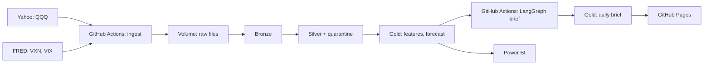

# QQQ Volatility Forecaster

Can I predict how much QQQ will swing over the next month better than the obvious guess, and how often does the options market overprice that swing?

## Results

From commit `837a186`, data fingerprint `130bd9a534cc0d3b`, prices through 2026-10-16. 20 test years (2007–2026), 4,958 out-of-sample days. Full output: `results/summary.json` and `results/model_scores.csv`.

| Model | MAE (vol pts) | vs. naive guess | Test years beating the naive guess |
|---|---|---|---|
| M0 Naive: last month repeats | 6.22 | — | — |
| M1 Market: VXN | 6.25 | −0.5% | 12 / 20 |
| **M2 Linear regression (champion)** | **4.82** | **+22.6%** | **18 / 20** |
| M3 Random forest | 5.07 | +18.5% | 17 / 20 |
| M4 XGBoost | 5.25 | +15.6% | 17 / 20 |

The simple regression beat the naive guess by 22.6% and won in 18 of the 20 years it never saw. It lost in 2009 and 2022. The tree models also beat the baseline, but they didn't add enough to justify the extra complexity.

**Overpricing (306 non-overlapping 21-day windows, 2001–2026):** VXN priced in a bigger swing than actually happened in 80.4% of windows, with a median premium of 4.4 vol points. The worst window, starting 2020-02-14, came in 66.5 points under realized volatility. That one month wiped out about 12 months of typical premium-seller gains.

The scoreboard is a proxy. It ignores transaction costs, contract details, and the exact payoff shape. This project measures forecasts. It is not a trading strategy and not financial advice.

## What it predicts

The annualized realized volatility of QQQ's daily log returns over the next 21 trading days, in vol points:

```
r_t = ln(adj_close_t / adj_close_{t-1})
y_t = 100 × sqrt( (252 / 21) × Σ_{i=1..21} r_{t+i}² )
```

VXN at the close of day t is the options market's estimate of the same quantity. VXN is built from Nasdaq-100 index options, not QQQ options. QQQ tracks the index closely, but they are not identical.

## Method

- **Features** (known at the close of day t): `rv_5`, `rv_21`, `rv_63`, `vxn`, `vix`, `vxn_minus_rv21`, `ret_21`, `drawdown_252`.
- **Models:** M0 naive (`rv_21`), M1 market (`vxn`), M2 linear regression on log `rv_5`, `rv_21`, `rv_63`, `vxn`, M3 random forest, M4 XGBoost. Fitted models predict `log(y)`. No tuning beyond fixed settings.
- **Testing:** walk-forward, expanding window from 2001, one refit per year, first test year 2007. The last 21 trading days before each test year are dropped from training because their targets overlap the test year.
- **Metric:** mean absolute error (MAE) in vol points, overall and per test year.
- **Champion rule:** lowest overall MAE among models that beat M0 in at least 60% of test years. Ties go to the simpler model.
- **Overpricing:** non-overlapping 21-day windows, `premium = vxn_t − y_t`.

Details: [model card](docs/model_card.md), [data sources](docs/data_sources.md), [decision records](docs/adr).

## Pipeline



- **Data quality:** duplicate dates, a low above the high, and non-positive prices are quarantined with a rule ID. Moves over 15% and gaps over 5 days are flagged. VXN and VIX outside 5–150 are nulled. A source with no new data for more than 2 trading days is marked stale, and scoring is skipped.
- **Daily brief:** a fixed LangGraph workflow drafts a short summary and checks every number against the data. After two failed checks it publishes a template instead. See [AI use review](docs/ai_use_review.md).
- **Operations:** every step writes to `ops.run_log`. Alerts and replay steps are in the [runbook](docs/runbook.md).

## Run it

```bash
python -m venv .venv
.venv/Scripts/pip install -r requirements-dev.txt -e .
qqq-volatility-forecaster ingest
qqq-volatility-forecaster backtest
qqq-volatility-forecaster daily
qqq-volatility-forecaster brief
qqq-volatility-forecaster site
pytest
```

`backtest` writes `results/summary.json` with the commit hash, whether `src/` had uncommitted changes, and a fingerprint of the input data. The exact input is saved under `data/snapshots/<fingerprint>/`, so any reported number can be reproduced.

## Layout

```
src/qqq_volatility_forecaster/
  ingest/      Yahoo and FRED downloads with retries
  quality/     data quality rules and quarantine
  features/    realized volatility and features
  models/      baselines, walk-forward splitter, training, evaluation
  vrp/         overpricing analysis
  brief/       LangGraph workflow, verifier, LLM client, prompt
  site/        static page renderer and template
  pipeline/    silver, backtest, daily, brief, site, Databricks exchange
  io/          the only module that reads or writes tables (CSV or Delta)
notebooks/     thin Databricks wrappers
resources/     Databricks job definitions
tests/         unit and end-to-end tests on synthetic data
```

## Limitations

- Daily close-to-close returns are a noisy measure of volatility. Intraday data would be better.
- VXN is an index-option measure applied to an ETF.
- About 5,000 test days across 20 years, with a handful of crisis periods carrying most of the error.

## Licenses

| Dependency | License |
|---|---|
| pandas, NumPy, scikit-learn, Jinja2 | BSD-3-Clause |
| XGBoost, yfinance, requests, tenacity | Apache-2.0 |
| LangGraph, anthropic | MIT |

Data: QQQ prices from Yahoo Finance for personal use. VXN and VIX from Cboe Global Markets via FRED, Federal Reserve Bank of St. Louis.
